# AegisShare — Secure File Sharing with Expiring Access and Audit Logs

[](https://aws.amazon.com/)
[](https://www.python.org/)
[](frontend/)
[](https://aegisshare.vercel.app/)
[](infrastructure/template.yaml)
[](backend/tests/)
[](LICENSE)

> **AegisShare** is an enterprise-grade, serverless secure file-sharing platform designed to eliminate uncontrolled digital asset dissemination. It implements ephemeral, time-bounded download links (Time-To-Live expiration), atomic download count limits (single-use or multi-use), on-demand link revocation, zero-knowledge cryptographic token storage, and an append-only, auto-scrubbed audit trail.

**Live Frontend Application:** [https://aegisshare.vercel.app/](https://aegisshare.vercel.app/)  
**Live Backend API Endpoint:** `https://bl7timg3se.execute-api.ap-south-1.amazonaws.com/dev`  
**Authors:** Bibek Sundaray & Dhananjay Saxena  

---

## Table of Contents

1. [Project Overview](#1-project-overview)
   - [The Problem AegisShare Solves](#the-problem-aegisshare-solves)
   - [Why Expiring Share Links?](#why-expiring-share-links)
   - [The Role of Revocation](#the-role-of-revocation)
   - [Why Structured Audit Logging Matters](#why-structured-audit-logging-matters)
   - [What Makes AegisShare Different?](#what-makes-aegisshare-different)
2. [Key Features](#2-key-features)
   - [Verified Implemented Capabilities](#verified-implemented-capabilities)
   - [Feature Implementation Matrix](#feature-implementation-matrix)
3. [System Architecture](#3-system-architecture)
   - [Architecture Diagram (Mermaid)](#architecture-diagram)
   - [Dual-Target Architecture](#dual-target-architecture)
   - [Component Responsibilities & Data Flow](#component-responsibilities--data-flow)
   - [Data Store Relationships](#data-store-relationships)
4. [Technology Stack & Design Choices](#4-technology-stack--design-choices)
5. [How the Application Works](#5-how-the-application-works)
   - [Workflow 1: File Upload](#workflow-1-file-upload)
   - [Workflow 2: Ephemeral Share Link Generation](#workflow-2-ephemeral-share-link-generation)
   - [Workflow 3: Non-Destructive Inspection & Recipient Download](#workflow-3-non-destructive-inspection--recipient-download)
   - [Workflow 4: Deterministic Expiration Validation](#workflow-4-deterministic-expiration-validation)
   - [Workflow 5: On-Demand Link Revocation](#workflow-5-on-demand-link-revocation)
   - [Workflow 6: Audit Event Telemetry & Scrubbing](#workflow-6-audit-event-telemetry--scrubbing)
6. [Deployed AWS Infrastructure](#6-deployed-aws-infrastructure)
7. [Repository Structure](#7-repository-structure)
8. [Installation & Local Development](#8-installation--local-development)
   - [Prerequisites](#prerequisites)
   - [Running the Local Demonstration Server](#running-the-local-demonstration-server)
   - [Running Automated Tests](#running-automated-tests)
   - [Connecting the Vercel Frontend to Local Backend](#connecting-the-vercel-frontend-to-local-backend)
9. [AWS Cloud Deployment](#9-aws-cloud-deployment)
   - [Prerequisites & IAM Permissions Boundary](#prerequisites--iam-permissions-boundary)
   - [Building with AWS SAM](#building-with-aws-sam)
   - [Deploying the Stack](#deploying-the-stack)
   - [CloudFormation Change Set Review](#cloudformation-change-set-review)
10. [Security Design & Threat Model](#10-security-design--threat-model)
    - [Verified Security Controls](#verified-security-controls)
    - [Honest Security Limitations](#honest-security-limitations)
11. [Testing & Verification Results](#11-testing--verification-results)
12. [Troubleshooting Guide](#12-troubleshooting-guide)
13. [Future Roadmap](#13-future-roadmap)
14. [Conclusion & Credits](#14-conclusion--credits)

---

## 1. Project Overview

### The Problem AegisShare Solves
In modern enterprise, legal, medical, and academic workflows, transferring confidential files is routine. However, conventional sharing channels expose organizations to significant security and compliance vulnerabilities:
- **Persistent Links:** Shared URLs created through standard cloud drives or email attachments frequently remain accessible indefinitely on the public internet. If an email inbox is compromised months later, or if a recipient forwards a message, sensitive data remains exposed.
- **Plaintext Database Leaks:** Many file-sharing utilities persist raw access tokens in cleartext within their databases. A single SQL injection vulnerability or database backup leak compromises every active link simultaneously.
- **No Atomic Download Caps:** Standard storage platforms do not allow creators to restrict links to single-use or $N$-use limits. An unauthorized party who intercepts a link can download the asset repeatedly without detection.
- **Opaque, Contaminated Audit Logs:** Organizations rarely maintain structured, immutable audit trails of access attempts. Moreover, when logs are captured, server access logs often record raw tokens or presigned AWS query strings in cleartext, creating a secondary data leak.
- **High Idle Costs:** Traditional server architectures (e.g., continuous EC2 instances or container clusters) incur round-the-clock hosting and patching costs even when the service is idle.

### Why Expiring Share Links?
An ephemeral link enforces a mathematical **Time-to-Live (TTL)**. By strictly restricting link validity to a short time window (e.g., 5 minutes, 1 hour, or 24 hours), the window of vulnerability is constrained. Even if a link is intercepted or forwarded after that window, the backend deterministic checks immediately reject the request.

### The Role of Revocation
Automated expiration handles expected lifecycles, but security incidents demand immediate human intervention. AegisShare provides an instantaneous **owner revocation kill-switch**. If a file owner realizes a link was dispatched to the wrong recipient or suspects an interception, they can revoke the token immediately, invalidating all subsequent access attempts before the TTL expires.

### Why Structured Audit Logging Matters
Accountability requires an unforgeable chronological record. AegisShare records every lifecycle event (`FILE_UPLOAD`, `SHARE_LINK_CREATED`, `DOWNLOAD_SUCCESS`, `ACCESS_REJECTED`, `TOKEN_REVOKED`) with UTC timestamps, actor IP addresses, and user-agent details. To prevent logs from becoming security risks themselves, AegisShare automatically scrubs plaintext tokens, passwords, and presigned AWS query strings before persistence.

### What Makes AegisShare Different?
Unlike standard file upload sites or generic storage tutorials, AegisShare implements:
1. **Zero-Knowledge Token Persistence:** Only one-way SHA-256 hashes of cryptographically random 256-bit access tokens are stored in the database. The server never retains the plaintext token; even a total database breach yields zero usable access tokens.
2. **Atomic Download Decrements:** Download counters are decremented atomically using DynamoDB conditional expressions, preventing race conditions or concurrent multi-download abuse.
3. **Dual-Target Execution:** A self-contained, zero-dependency local demonstration stack for offline academic evaluation, accompanied by an enterprise-grade AWS SAM template for serverless cloud deployment.
4. **Hardened Cloud Controls:** Complete S3 public-access blocking, AES-256 server-side encryption, TLS-only transport enforcement, and IAM least-privilege scoping governed by permissions boundaries.

---

## 2. Key Features

### Verified Implemented Capabilities

- **Secure Encrypted Storage:**
  - Files stored in Amazon S3 with Server-Side Encryption (`AES256`).
  - S3 Block Public Access enabled across all four bucket flags.
  - Bucket policy strictly denies non-HTTPS requests (`aws:SecureTransport = false`).
  - Local demo storage with strict basename sanitization against directory traversal (`../`).
- **File Metadata Registry:**
  - Tracks unique system identifier (`file_<hex>`), original filename, exact byte size, MIME content-type, upload timestamp (UTC), and storage backend adapter.
- **Cryptographic Share-Link Generation:**
  - Generates 256-bit cryptographically secure raw tokens via Python's `secrets.token_urlsafe(32)`.
  - Computes and persists only the SHA-256 hash (`hashlib.sha256`) in DynamoDB.
  - Configurable lifespan (e.g., 60 seconds up to 7 days).
  - Configurable download ceiling (single-use, custom $N$-use, or unlimited).
- **Backend Deterministic Expiration:**
  - Timestamp verification enforced directly in backend code (`now_utc >= expires_at_utc`).
  - DynamoDB native TTL attribute (`ttl` in epoch seconds) enables automatic background item purging.
  - Expired link requests return `HTTP 410 Gone` with explicit error codes (`ACCESS_EXPIRED`).
- **Recipient Download Portal & Non-Destructive Inspection:**
  - Interactive web portal (`/?token=...`) with real-time countdown timer.
  - Non-destructive inspection endpoint (`GET /api/tokens/inspect?token=...`) queries metadata and remaining downloads without consuming an access count.
  - Valid download requests atomically increment the download counter and generate short-lived (300s) presigned S3 GET URLs, issuing an `HTTP 302` redirect or JSON response.
- **Instantaneous Link Revocation:**
  - File creators can revoke active tokens via `POST /api/revoke` using the raw token or token hash.
  - Sets `is_revoked = True` and records `revoked_at_utc`. Subsequent access attempts return `HTTP 403 Forbidden` (`TOKEN_REVOKED`).
- **Sanitized Audit Trail Explorer:**
  - Append-only audit logger capturing full lifecycle telemetry.
  - Automatic redacting of sensitive fields (`token`, `password`, `authorization`).
  - Automated scrubbing of presigned URL query strings to prevent credential leakage.
  - Multi-criteria filtering in the dashboard by file ID, event type, and outcome (`SUCCESS` vs `DENIED`).
- **Unified Serverless API Dispatcher:**
  - Amazon API Gateway HTTP API (v2) with CORS preflight handling.
  - Single modular Lambda router (`backend/handlers/api_dispatcher.py`) with intelligent stage-prefix normalization (`/dev/api/*` vs `/api/*`).
  - CloudWatch Log Group with cost-optimized 7-day retention.

### Feature Implementation Matrix

| Feature | Local Demo Mode | AWS Serverless Cloud Mode | Verification Status |
| :--- | :---: | :---: | :---: |
| **File Upload & Storage** | Local Disk (`local_storage/files/`) | Amazon S3 (`AES256` SSE) | Verified (Local & Mocked S3) |
| **Path Traversal Protection** | Yes (`Path.name` sanitization) | Native S3 object key isolation | Verified (4 Tests) |
| **Token Cryptography (256-bit)** | Yes (`secrets.token_urlsafe`) | Yes (`secrets.token_urlsafe`) | Verified (7 Tests) |
| **Zero-Knowledge Hashing** | SHA-256 In-Memory / Local Store | SHA-256 DynamoDB Table | Verified (5 Tests) |
| **UTC Expiration Enforcement** | Python UTC timestamp check | Python check + DynamoDB TTL | Verified (8 Tests) |
| **Atomic Download Caps** | Python thread-safe counter | DynamoDB `attribute_exists` update | Verified (5 Tests) |
| **Immediate Link Revocation** | In-Memory / Local State | DynamoDB conditional update | Verified (5 Tests) |
| **Sensitive Log Sanitization** | JSONL logger auto-scrub | DynamoDB auto-scrub | Verified (3 Tests) |
| **Recipient UI & Countdown** | Vanilla JS Web Portal | Vanilla JS Web Portal | Verified (Browser & E2E) |
| **Automated Test Coverage** | 47 / 47 Tests Passing | IaC & Handler Mocks Passing | Verified (`unittest`) |

---

## 3. System Architecture

### Architecture Diagram

The following Mermaid diagram illustrates the end-to-end architecture of AegisShare, showing the dual-target execution model (Local Demo vs AWS Serverless Cloud), data stores, and telemetry pipelines:

```mermaid
graph TB
    subgraph ClientTier ["Client Presentation Tier (Browser)"]
        UI["AegisShare Dashboard SPA<br/>(Hosted on Vercel: aegisshare.vercel.app)"]
        Portal["Recipient Download Portal<br/>(Query param: ?token=...)"]
    end

    subgraph ModeSelection ["Execution / Target Environment"]
        ModeLocal["MODE 1: Local Demonstration Mode<br/>(Python 3.12 / 3.14 Standard Library)"]
        ModeAWS["MODE 2: Production Serverless AWS Mode<br/>(Region: ap-south-1 | Stack: aegisshare-app)"]
    end

    UI --> ModeSelection
    Portal --> ModeSelection

    %% ================= LOCAL STACK =================
    subgraph LocalStack ["Local Demonstration Stack (backend/local_server.py)"]
        LocalServer["Local HTTP Server<br/>(ThreadingHTTPServer on port 8000)"]
        LocalStorage[("Local Vault Storage<br/>local_storage/files/")]
        LocalAudit[("Append-Only Audit Log<br/>local_storage/audit_log.jsonl")]
        LocalMemoryTokens[("In-Memory Token Registry<br/>(SHA-256 Hashed Tokens)")]

        LocalServer --> LocalStorage
        LocalServer --> LocalAudit
        LocalServer --> LocalMemoryTokens
    end

    ModeLocal --> LocalServer

    %% ================= AWS CLOUD STACK =================
    subgraph AWSCloud ["AWS Serverless Cloud Environment (ap-south-1)"]
        ApiGw["Amazon API Gateway (HTTP API v2)<br/>(CORS Enabled, Base: /dev)"]

        subgraph ComputeTier ["Compute Tier: AWS Lambda (Python 3.12)"]
            Dispatcher["api_dispatcher<br/>(Path Normalizer & Route Dispatcher)"]
            UploadFn["upload_handler"]
            ShareFn["share_handler"]
            DownloadFn["download_handler"]
            InspectFn["inspect_handler"]
            RevokeFn["revoke_handler"]
            AuditFn["audit_handler"]
            TokensFn["tokens_handler"]
            FilesFn["files_handler"]
            HealthFn["health_handler"]

            Dispatcher --> UploadFn
            Dispatcher --> ShareFn
            Dispatcher --> DownloadFn
            Dispatcher --> InspectFn
            Dispatcher --> RevokeFn
            Dispatcher --> AuditFn
            Dispatcher --> TokensFn
            Dispatcher --> FilesFn
            Dispatcher --> HealthFn
        end

        subgraph StorageTier ["Storage Tier: Amazon S3"]
            S3Bucket[("Private S3 Vault<br/>aegisshare-secure-vault-dev-137327915859<br/>(SSE-AES256, Enforce TLS, Block Public Access)")]
        end

        subgraph DatabaseTier ["Database Tier: Amazon DynamoDB (On-Demand)"]
            DdbFiles[("FilesMetadataTable<br/>aegisshare-files-dev<br/>(PK: file_id)")]
            DdbTokens[("ShareTokensTable<br/>aegisshare-tokens-dev<br/>(PK: token_hash, TTL: ttl, GSI: FileIdIndex)")]
            DdbAudit[("AuditLogsTable<br/>aegisshare-audit-logs-dev<br/>(PK: event_id, GSI: FileIdEventsIndex)")]
        end

        subgraph GovernanceTier ["Governance, Security & Monitoring"]
            IAM["IAM Lambda Execution Role<br/>(Least-Privilege Scoped + Permissions Boundary)"]
            CW["Amazon CloudWatch Logs<br/>(/aws/lambda/aegisshare-app-* | 7-Day Retention)"]
        end

        ApiGw --> Dispatcher

        UploadFn -.-> S3Bucket
        UploadFn -.-> DdbFiles
        UploadFn -.-> DdbAudit

        ShareFn -.-> DdbFiles
        ShareFn -.-> DdbTokens
        ShareFn -.-> DdbAudit

        DownloadFn -.-> DdbTokens
        DownloadFn -.-> S3Bucket
        DownloadFn -.-> DdbAudit

        InspectFn -.-> DdbTokens
        InspectFn -.-> DdbFiles

        RevokeFn -.-> DdbTokens
        RevokeFn -.-> DdbAudit

        AuditFn -.-> DdbAudit
        TokensFn -.-> DdbTokens
        FilesFn -.-> DdbFiles

        ComputeTier --- IAM
        ComputeTier --- CW
    end

    ModeAWS --> ApiGw

    %% Styling
    classDef client fill:#1e293b,stroke:#38bdf8,stroke-width:2px,color:#fff;
    classDef local fill:#0f172a,stroke:#10b981,stroke-width:2px,color:#fff;
    classDef aws fill:#0c192c,stroke:#f59e0b,stroke-width:2px,color:#fff;
    classDef db fill:#1e1b4b,stroke:#a855f7,stroke-width:2px,color:#fff;

    class UI,Portal client;
    class LocalServer,LocalStorage,LocalAudit,LocalMemoryTokens local;
    class ApiGw,Dispatcher,UploadFn,ShareFn,DownloadFn,InspectFn,RevokeFn,AuditFn,TokensFn,FilesFn,HealthFn,S3Bucket,IAM,CW aws;
    class DdbFiles,DdbTokens,DdbAudit db;
```



### Dual-Target Architecture
A core engineering achievement of AegisShare is its **dual-target execution model**:
1. **Local Demonstration Mode:** Implemented in `backend/local_server.py`. Runs entirely on Python's built-in standard library (`http.server.ThreadingHTTPServer`, `urllib`, `secrets`, `hashlib`, `json`). It requires **zero external pip dependencies**, operates completely offline, stores binary objects in `local_storage/files/`, and writes audit records to `local_storage/audit_log.jsonl`. This guarantees immediate, frictionless reproduction for evaluators on any workstation.
2. **Production AWS Serverless Mode:** Defined in `infrastructure/template.yaml`. Maps the exact same REST API routes to AWS Lambda, Amazon API Gateway HTTP API v2, Amazon S3, and Amazon DynamoDB. The application logic automatically routes through `backend.handlers.api_dispatcher.lambda_handler`.

### Component Responsibilities & Data Flow

| Component | Technology | Responsibility |
| :--- | :--- | :--- |
| **Client Frontend** | Vanilla HTML5 / CSS3 / ES6 | Dashboard for vault management, share link creation with expiration pickers, audit log explorer, and recipient countdown portal. |
| **API Ingress** | Amazon API Gateway (HTTP v2) | Low-latency HTTP entry point; handles CORS preflights and routes requests to the Lambda integration. |
| **Compute Router** | `api_dispatcher.py` (Lambda) | Normalizes request paths (handling stage prefixes like `/dev`), extracts actor IP and user agents, and invokes specific modular handlers. |
| **Encrypted Vault** | Amazon S3 | Secure, highly durable object storage. Configured with AES-256 encryption, TLS-only bucket policy, and private access blocks. |
| **File Metadata Registry** | DynamoDB (`aegisshare-files-dev`) | Stores file catalog records: unique `file_id`, filename, size, MIME type, upload timestamp, and storage path. |
| **Token Registry** | DynamoDB (`aegisshare-tokens-dev`) | Stores zero-knowledge SHA-256 token hashes, expiration timestamps, atomic download counters, revocation flags, and native TTL. |
| **Audit Log Store** | DynamoDB (`aegisshare-audit-logs-dev`) | Immutable chronological repository of all security events with sensitive data scrubbed. |
| **Execution Logging** | Amazon CloudWatch Logs | Captures Lambda runtime logs and exceptions with a cost-optimized 7-day retention period. |

### Data Store Relationships

```text
Amazon S3 (Encrypted Storage)
└── uploads/{file_id}              [Binary Object Blob]
          ▲
          │ (1 : 1 relationship by file_id)
          ▼
DynamoDB: FilesMetadataTable
└── PK: file_id                    [Metadata: filename, size, MIME type, timestamp]
          ▲
          │ (1 : N relationship by file_id via GSI: FileIdIndex)
          ▼
DynamoDB: ShareTokensTable
└── PK: token_hash (SHA-256)       [Access State: expires_at_utc, max_downloads, download_count, is_revoked, ttl]
          ▲
          │ (Referenced during access events via token_hash_prefix)
          ▼
DynamoDB: AuditLogsTable
└── PK: event_id                   [Audit Event: event_type, outcome, actor_ip, timestamp_utc, scrubbed details]
    GSI: file_id + timestamp_utc   [Chronological event ordering per file]
```

---

## 4. Technology Stack & Design Choices

| Technology | Category | Role in AegisShare | Technical Justification |
| :--- | :--- | :--- | :--- |
| **HTML5, CSS3, JavaScript** | Frontend Presentation | Client Single-Page App (SPA) | Pure Vanilla implementation with **zero node_modules build step**. Eliminates supply chain attack vectors, loads instantaneously, and uses native browser Fetch and Web Crypto APIs. Modern cybersecurity-themed dark UI using Google Fonts (`Inter` & `JetBrains Mono`). |
| **Vercel** | Edge Hosting | Frontend Static Hosting | High-availability global edge CDN delivering the static assets (`index.html`, `styles.css`, `app.js`) over automated TLS with sub-50ms latency worldwide. |
| **AWS API Gateway (HTTP v2)** | API Ingress | REST Routing & CORS | 70% cheaper and lower latency than traditional REST APIs ($1.00/million requests vs $3.50). Native CORS support and direct proxy integration with AWS Lambda. |
| **AWS Lambda** | Serverless Compute | Backend Micro-Handlers | Python 3.12 runtime with 256MB memory and 15s timeout. Zero idle compute cost. Python's built-in cryptographic libraries (`secrets`, `hashlib`) and pre-bundled `boto3` eliminate heavy container packaging. Cold starts are sub-500ms. |
| **Amazon S3** | Object Storage | Encrypted Document Vault | 99.999999999% (11 9s) data durability. Hardened with SSE-S3 (`AES256`), all four Public Access Block settings enabled, and a bucket policy enforcing TLS 1.2+ (`aws:SecureTransport = false` denied). |
| **Amazon DynamoDB** | NoSQL Database | Metadata, Tokens & Audit | On-demand billing (`PAY_PER_REQUEST`) with zero baseline cost. Native Time-To-Live (TTL) automatically evicts expired tokens without compute overhead. Conditional writes prevent concurrent download race conditions. |
| **Amazon CloudWatch** | Monitoring & Telemetry | Runtime Execution Logs | Aggregates Lambda function stdout/stderr and error traces. Retention configured to **7 days** to minimize cloud storage expenses for demonstration workloads. |
| **AWS SAM & CloudFormation** | Infrastructure as Code | Declarative Cloud IaC | Standardized infrastructure definitions in `infrastructure/template.yaml`. Provides linting (`sam validate --lint`), changeset reviews (`confirm_changeset = true`), and reproducible multi-environment deployments. |

---

## 5. How the Application Works

Access enforcement must take place on the backend. The frontend UI facilitates user interactions and displays cosmetic timers, but all security guarantees (cryptographic validation, expiration, download ceilings, and revocation) are strictly enforced in Python before any file data is accessed.

### Workflow 1: File Upload

```text
[Browser] ──(1) Select File──> [Frontend] ──(2) POST /api/upload (Multipart/Binary)──> [Backend / S3]
                                                                                              │
[Browser] <──(5) Return 201 Created (file_id)── [Backend] <──(4) Record Audit── [DynamoDB Audit]
                                                    │
                                                    └──(3) Save Metadata──> [DynamoDB Files]
```

1. **User Action:** The user drags a file into the upload dropzone or selects it via the file browser.
2. **Frontend Dispatch:** The client issues `POST /api/upload` containing the file payload.
3. **Backend Processing:**
   - The backend generates a cryptographically random file identifier: `file_id = f"file_{secrets.token_hex(6)}"`.
   - In AWS mode, the handler saves the binary payload directly into the private S3 bucket under `uploads/{file_id}` with `AES256` server-side encryption. (The architecture also supports issuing a presigned `PUT` URL for large payloads).
   - In local mode, the payload is written to `local_storage/files/{file_id}` after strict basename sanitization.
4. **Metadata & Audit Registration:**
   - A `FileMetadata` record is persisted to `aegisshare-files-dev`.
   - A `FILE_UPLOAD` audit record is appended to `aegisshare-audit-logs-dev` recording filename, byte size, MIME type, and client IP.
5. **Client Response:** The backend responds with `HTTP 201 Created` containing the `file_id`. The UI updates the file vault table immediately.

---

### Workflow 2: Ephemeral Share Link Generation

```text
[User] ──(1) Select File, TTL & Max Downloads──> [Frontend] ──(2) POST /api/share──> [Backend]
                                                                                         │
                                         ┌───────────────────────────────────────────────┤
                                         │ Generate raw_token (secrets.token_urlsafe)    │
                                         │ Compute SHA-256 hash (hashlib.sha256)         │
                                         │ Calculate UTC Expiry & DynamoDB epoch TTL     │
                                         └───────────────────────────────────────────────┘
                                                         │
[User] <──(5) Return raw_token & share_url (201) ────────┴──(3) Store Hash──> [DynamoDB Tokens]
                                                         │
                                                         └──(4) Record Audit──> [DynamoDB Audit]
```

1. **User Configuration:** The creator chooses a file from the vault, specifies a Time-To-Live duration (e.g., 60 seconds, 1 hour, or 24 hours), and defines an optional download ceiling (e.g., 1 download for single-use, 5 downloads, or unlimited).
2. **Frontend Dispatch:** The client issues `POST /api/share` with `{ "file_id": "...", "expires_in_seconds": 3600, "max_downloads": 1 }`.
3. **Backend Cryptographic Operations:**
   - The backend validates that `file_id` exists.
   - It generates a 256-bit entropy token using `secrets.token_urlsafe(32)`.
   - It immediately computes the one-way cryptographic SHA-256 hash: `token_hash = hashlib.sha256(raw_token.encode()).hexdigest()`.
   - It computes the UTC expiration timestamp (`now_utc + expires_in_seconds`) and DynamoDB TTL epoch timestamp.
   - The `TokenRecord` is written to `aegisshare-tokens-dev` using `token_hash` as the partition key.
4. **Audit Logging:** An audit entry (`SHARE_LINK_CREATED`) is recorded. To preserve zero-knowledge security, only the first 12 characters of the hash (`token_hash_prefix`, e.g., `a1b2c3d4e5f6...`) are stored; **the raw token is never written to logs**.
5. **Client Response:** The backend returns `HTTP 201 Created` with `raw_token` and the complete `share_url`. The UI displays the full link with a clear notice: *The plaintext token is displayed once. It is not saved on the server.*

---

### Workflow 3: Non-Destructive Inspection & Recipient Download

```text
[Recipient Browser] ──(1) Open /?token=RAW_TOKEN──> [Download Portal UI]
                                                            │
                                  (2) GET /api/tokens/inspect?token=RAW_TOKEN
                                                            │
                                                            ▼
                                                     [Backend Lambda]
                                                            │
                                        ┌───────────────────┴───────────────────┐
                                        │ Hash RAW_TOKEN -> Query DynamoDB      │
                                        │ Check: Valid / Expired / Exhausted    │
                                        └───────────────────┬───────────────────┘
                                                            │
[Portal UI: Live Countdown] <──(3) Return Status & Metadata ┘
            │
[Recipient] ──(4) Click "Download File Now" ──> GET /api/download?token=RAW_TOKEN
                                                                │
                                                        [Backend Lambda]
                                                                │
                                            ┌───────────────────┴───────────────────┐
                                            │ Atomic Conditional Decrement          │
                                            │ Generate S3 Presigned GET (300s)      │
                                            │ Record DOWNLOAD_SUCCESS in Audit      │
                                            └───────────────────┬───────────────────┘
                                                                │
[Recipient Browser] <──(5) HTTP 302 Redirect to Presigned S3 URL ┘
        │
        └──(6) Direct Encrypted Download──> [Amazon S3 Vault]
```

1. **Accessing the Portal:** The recipient opens `https://aegisshare.vercel.app/?token=<RAW_TOKEN>`.
2. **Non-Destructive Inspection:** Before consuming the download limit, the portal calls `GET /api/tokens/inspect?token=<RAW_TOKEN>`. The backend hashes the raw token, checks the record status, and returns the original filename, file size, remaining time, and remaining downloads.
3. **Live UI State:** The portal renders a live countdown timer syncing against the server's UTC timestamp and displays the remaining download count.
4. **Download Execution:** The recipient clicks **Download File Now**, invoking `GET /api/download?token=<RAW_TOKEN>`.
5. **Atomic Validation & Token Consumption:**
   - The backend hashes the raw token and retrieves the token record.
   - It validates that `now_utc < expires_at_utc`, `is_revoked == False`, and `download_count < max_downloads`.
   - It performs an atomic conditional update on DynamoDB to increment `download_count`.
   - It generates a short-lived (300 seconds) presigned S3 GET URL.
   - A `DOWNLOAD_SUCCESS` audit event is emitted.
6. **Binary Delivery:** The backend responds with `HTTP 302 Found` with the `Location` header pointing directly to the presigned S3 URL (or returns JSON if `format=json`). The recipient's browser fetches the file directly and securely from S3.

---

### Workflow 4: Deterministic Expiration Validation

```text
Recipient Request ──> GET /api/download?token=RAW_TOKEN ──> [Backend Validator]
                                                                   │
                                                ┌──────────────────┴──────────────────┐
                                                │ now_utc >= expires_at_utc           │
                                                └──────────────────┬──────────────────┘
                                                                   │
Client Error <── HTTP 410 Gone (ACCESS_EXPIRED) ───────────────────┼── Record ACCESS_REJECTED
                                                                   └──> [DynamoDB Audit]
```

1. Even if the client attempts to bypass the frontend timer or submits a direct HTTP request, the backend immediately checks `now_utc >= expires_at_utc`.
2. If expired, execution halts immediately:
   - The download counter is **not** decremented.
   - No presigned S3 URL is generated.
   - An `ACCESS_REJECTED` audit event is logged (`outcome: DENIED`, `reason: Access token expired`).
   - The API returns `HTTP 410 Gone` with `{ "error": "ACCESS_EXPIRED" }`.
3. Concurrently, DynamoDB's native TTL mechanism automatically deletes the stale token item from storage within 48 hours without consuming write capacity.

---

### Workflow 5: On-Demand Link Revocation

```text
[Owner] ──(1) Click "Revoke Link"──> [Frontend] ──(2) POST /api/revoke (token_hash)──> [Backend]
                                                                                           │
                                                                   ┌───────────────────────┤
                                                                   │ Set is_revoked = True │
                                                                   │ Set revoked_at_utc    │
                                                                   └───────────────────────┘
                                                                                           │
[Owner UI: Status = REVOKED] <──(5) Return 200 OK ─────────────────┴──(3) Update Item ──> [DynamoDB Tokens]
                                                                   │
                                                                   └──(4) Record Audit ──> [DynamoDB Audit]
```

1. **Owner Action:** In the dashboard's **Share Links Management** table, the creator locates an active link and clicks **Revoke Link**.
2. **Frontend Dispatch:** The client issues `POST /api/revoke` with `{ "token_hash": "..." }` (or the raw token).
3. **Backend Execution:** The backend updates the record in DynamoDB, setting `is_revoked = True` and recording the exact `revoked_at_utc` timestamp.
4. **Audit Logging:** A `TOKEN_REVOKED` audit record is written.
5. **Immediate Termination:** Any subsequent inspection or download attempt immediately raises `TokenRevokedError`, records an `ACCESS_REJECTED` audit event (`reason: Token was revoked by owner`), and returns `HTTP 403 Forbidden` (`TOKEN_REVOKED`).

---

### Workflow 6: Audit Event Telemetry & Scrubbing

```text
Security Event Triggered (Upload / Share / Download / Revoke / Denied)
                    │
                    ▼
     [AuditService.record_event()]
                    │
    ┌───────────────┴───────────────┐
    │ 1. Scrub plaintext tokens     │
    │ 2. Scrub passwords/auth keys  │
    │ 3. Strip presigned S3 queries │
    │ 4. Retain safe hash prefix    │
    └───────────────┬───────────────┘
                    │
                    ▼
       [DynamoDB AuditLogsTable]
     (or local_storage/audit_log.jsonl)
                    │
                    ▼
         GET /api/audit?file_id=...
                    │
                    ▼
     [Frontend Audit Trail Explorer]
```

1. Every critical operation triggers `AuditService.record_event()` with structured fields: `event_id`, `timestamp_utc`, `event_type`, `file_id`, `outcome`, `actor_ip`, `user_agent`, `token_hash_prefix`, and `details`.
2. **Automated Scrubbing:**
   - Any sensitive dictionary key (`token`, `password`, `secret`, `authorization`, `credentials`) is replaced with `[REDACTED_SENSITIVE_DATA]`.
   - Any URL containing query parameters (such as AWS presigned URL signatures like `X-Amz-Signature`) has its query parameters completely stripped: `[QUERY_STRIPPED_FOR_AUDIT]`.
   - Raw tokens are never logged; only safe 12-character SHA-256 prefixes are recorded.
3. **Persistence & Viewing:** The event is written to `aegisshare-audit-logs-dev`. The dashboard queries `GET /api/audit` to render the audit table with real-time multi-criteria filtering.

---

## 6. Deployed AWS Infrastructure

The production serverless environment is provisioned in the **Asia Pacific (Mumbai) `ap-south-1`** region using AWS SAM and CloudFormation under stack name `aegisshare-app`.

> **Note on Configuration vs. Credentials:**  
> The identifiers below represent the project's public cloud resource configuration and endpoints. They contain zero credentials, secret keys, or private tokens.

| AWS Resource | Resource Name / Physical ID | Configuration & Security Highlights |
| :--- | :--- | :--- |
| **AWS Region** | `ap-south-1` | Asia Pacific (Mumbai) region. |
| **CloudFormation Stack** | `aegisshare-app` | Managed via AWS SAM (`infrastructure/template.yaml`). |
| **API Gateway (HTTP v2)** | `HttpApiGateway` (`bl7timg3se`) | HTTP API v2 with CORS enabled, stage name: `dev`. |
| **Live API Base URL** | `https://bl7timg3se.execute-api.ap-south-1.amazonaws.com/dev` | Production API endpoint serving all backend REST routes. |
| **Live Frontend URL** | `https://aegisshare.vercel.app/` | Production single-page dashboard hosted on Vercel. |
| **AWS Lambda Function** | `AegisShareApiFunction` | Python 3.12, 256 MB memory, 15s timeout, unified dispatcher. |
| **Amazon S3 Vault** | `aegisshare-secure-vault-dev-137327915859` | Private bucket, Server-Side Encryption (`AES256`), 4x Public Access Block enabled, HTTPS-only bucket policy. |
| **DynamoDB: Files** | `aegisshare-files-dev` | Partition Key: `file_id` (String). On-demand billing (`PAY_PER_REQUEST`). |
| **DynamoDB: Tokens** | `aegisshare-tokens-dev` | Partition Key: `token_hash` (String). GSI: `FileIdIndex`. Native TTL enabled on `ttl`. |
| **DynamoDB: Audit Logs** | `aegisshare-audit-logs-dev` | Partition Key: `event_id` (String). GSI: `FileIdEventsIndex` (`file_id` + `timestamp_utc`). |
| **CloudWatch Log Group** | `/aws/lambda/aegisshare-app-AegisShareApiFunction-*` | Automated runtime logging with cost-optimized 7-day log retention. |
| **Target AWS Account** | `137327915859` | Target account for the capstone deployment. |

---

## 7. Repository Structure

The actual file structure of the AegisShare repository is organized as follows:

```text
D:\AWS SECURE FILE SHARING\
├── .gitignore                      # Git exclusion rules (secrets, venvs, SAM artifacts)
├── PROGRESS.md                     # Engineering progress tracker and verification records
├── README.md                       # Comprehensive project documentation (this document)
├── aegisshare_sample.txt           # Non-sensitive sample test document for uploads
├── samconfig.toml                  # AWS SAM deployment configuration (dev stage, ap-south-1)
│
├── frontend/                       # Vanilla Single-Page Application (SPA)
│   ├── index.html                  # Dashboard UI, Vault table, Share manager, Recipient Portal
│   ├── styles.css                  # Modern cyber-security dark theme styling & animations
│   └── app.js                      # Client state, API config, live countdown timer, dropzone logic
│
├── backend/                        # Serverless Python application codebase
│   ├── __init__.py                 # Python package marker
│   ├── local_server.py             # Standalone zero-dependency local demo HTTP server
│   ├── README.md                   # Backend architecture and services reference
│   │
│   ├── handlers/                   # Modular AWS Lambda handler functions
│   │   ├── __init__.py             # Handlers package marker
│   │   ├── api_dispatcher.py       # Unified router & API Gateway stage-prefix normalizer
│   │   ├── api_gateway_proxy.py    # Request parser & standardized JSON/CORS response formatter
│   │   ├── upload_handler.py       # Handles file uploads and S3 presigned PUT generation
│   │   ├── share_handler.py        # Generates 256-bit tokens, hashes to SHA-256, records state
│   │   ├── download_handler.py     # Atomically decrements count & generates presigned GET URL
│   │   ├── inspect_handler.py      # Non-destructive token validation for recipient portal
│   │   ├── revoke_handler.py       # On-demand link revocation handler
│   │   ├── audit_handler.py        # Query handler for filtered audit event telemetry
│   │   ├── files_handler.py        # Vault file inventory handler
│   │   ├── tokens_handler.py       # Active share link query handler
│   │   └── health_handler.py       # System health check and backend identification
│   │
│   ├── services/                   # Core business logic and persistence abstractions
│   │   ├── __init__.py             # Services package marker
│   │   ├── token_service.py        # Token cryptography, SHA-256 hashing, UTC expiration logic
│   │   ├── storage_service.py      # Abstract storage interface, LocalStorage & S3StorageService
│   │   ├── audit_service.py        # Structured immutable audit engine with auto-redaction
│   │   └── dynamodb_service.py     # DynamoDB client adapters (Files, Tokens with TTL, Audit)
│   │
│   └── tests/                      # Automated unit, integration, and IaC test suite
│       ├── __init__.py             # Tests package marker
│       ├── test_token_service.py    # 7 tests: Cryptography, hashing, UTC expiration, limits
│       ├── test_storage_service.py  # 7 tests: Local isolation, traversal defense, S3 adapter
│       ├── test_audit_service.py    # 3 tests: Event logging, sensitive field redaction, reload
│       ├── test_integration_flow.py # 3 tests: Full lifecycle (upload -> share -> download -> exhaustion)
│       ├── test_local_server.py     # 2 tests: Live local HTTP socket server REST endpoints
│       ├── test_dynamodb_service.py # 5 tests: DynamoDB CRUD, atomic consumption, conditional writes
│       ├── test_lambda_handlers.py  # 11 tests: API Gateway proxy parsing, CORS, dispatcher routing
│       └── test_sam_template.py     # 9 tests: SAM syntax, S3 encryption, DynamoDB TTL, IAM policies
│
├── infrastructure/                 # Infrastructure as Code (AWS SAM / CloudFormation)
│   └── template.yaml               # Hardened SAM template (S3, DynamoDB, API Gateway, Lambda, IAM)
│
├── docs/                           # Technical reports, architecture diagrams & security policies
│   ├── architecture.mmd            # Mermaid source for the complete system architecture diagram
│   ├── DEMO_CHECKLIST.md           # Examiner demonstration script & evidence checklist
│   ├── DEPLOYMENT_STATUS.md        # Pre-deployment security review & IAM permission hardening
│   ├── Project_Report.md           # Comprehensive 44KB technical college capstone report
│   ├── TESTING_GUIDE.md            # Detailed testing procedures & scenario walkthroughs
│   ├── deployment-policy.json      # Hardened IAM policy for deployment CI/CD user
│   ├── lambda-execution-policy.json# Least-privilege IAM policy for Lambda execution role
│   └── lambda-permissions-boundary.json # IAM Permissions Boundary restricting Lambda role capabilities
│
└── local_storage/                  # Local demonstration runtime data (git-ignored)
    ├── files/                      # Local storage binary objects (isolated by safe file_id)
    ├── metadata/                   # Local file metadata descriptors
    └── audit_log.jsonl             # Local append-only JSON Lines structured audit trail
```

---

## 8. Installation & Local Development

AegisShare requires **zero third-party pip dependencies** to run locally. It uses Python's standard library for all cryptography, HTTP networking, and persistence.

### Prerequisites

| Tool | Minimum Version | Purpose |
| :--- | :--- | :--- |
| **Python** | 3.10+ (Tested on 3.12 & 3.14) | Backend runtime, local server, and test runner. |
| **Web Browser** | Modern (Edge, Chrome, Firefox) | Accessing the client frontend dashboard. |
| **Git** | 2.x+ | Version control and repository management. |
| **AWS CLI v2** | *Optional for local dev* | Required only when deploying to AWS. |
| **AWS SAM CLI** | *Optional for local dev* | Required only when building/deploying cloud IaC. |

### Running the Local Demonstration Server

1. Open a terminal (PowerShell, Command Prompt, or Bash) and navigate to the repository root:
   ```powershell
   cd "D:\AWS SECURE FILE SHARING"
   ```

2. Start the standalone demonstration server:
   ```powershell
   python backend/local_server.py --port 8000
   ```

3. The server starts immediately and outputs:
   ```text
   ======================================================================
   AegisShare - Local Demonstration HTTP Server
   Storage Backend : local_demo_storage
   Base Directory  : D:\AWS SECURE FILE SHARING\local_storage
   Frontend Assets : D:\AWS SECURE FILE SHARING\frontend
   Server Address  : http://127.0.0.1:8000
   ======================================================================
   ```

4. Open your browser and navigate to:
   ```text
   http://127.0.0.1:8000
   ```
   The complete dashboard will load, connected directly to your local backend.

### Running Automated Tests

AegisShare includes a test suite covering cryptography, token lifecycles, storage adapters, DynamoDB operations, Lambda proxy event dispatching, and SAM IaC templates:

```powershell
python -m unittest discover -s backend/tests -v
```

**Expected Execution Output:**
```text
Ran 47 tests in 0.787s

OK
```

All 47 tests execute in under 1 second without connecting to external AWS resources (using built-in mocks and adapters).

### Connecting the Vercel Frontend to Local Backend

The live frontend on Vercel ([https://aegisshare.vercel.app/](https://aegisshare.vercel.app/)) can connect to either the live AWS backend or your local demonstration server:
1. Open [https://aegisshare.vercel.app/](https://aegisshare.vercel.app/).
2. Click the **API Endpoint Config** gear icon in the top header or lower navigation.
3. Enter `http://127.0.0.1:8000` (for local development) or `https://bl7timg3se.execute-api.ap-south-1.amazonaws.com/dev` (for live AWS).
4. Click **Save & Reconnect**. The frontend immediately updates its target and syncs data via CORS.

---

## 9. AWS Cloud Deployment

Deploying AegisShare to AWS uses the Serverless Application Model (SAM). The infrastructure is defined declaratively in `infrastructure/template.yaml` and configured via `samconfig.toml`.

### Prerequisites & IAM Permissions Boundary

Before deploying:
1. Ensure AWS CLI v2 is installed and authenticated:
   ```powershell
   aws sts get-caller-identity
   ```
2. For hardened environments requiring an **IAM Permissions Boundary**, create the managed boundary policy using `docs/lambda-permissions-boundary.json`:
   ```powershell
   aws iam create-policy \
       --policy-name AegisShareLambdaExecutionBoundary \
       --policy-document file://docs/lambda-permissions-boundary.json
   ```

### Building with AWS SAM

1. Validate the SAM template against AWS CloudFormation specifications and lint rules:
   ```powershell
   sam validate --lint -t infrastructure/template.yaml
   ```
   *Expected result: `infrastructure/template.yaml is a valid SAM Template`.*

2. Build the serverless application artifact:
   ```powershell
   sam build -t infrastructure/template.yaml
   ```
   *The built package size is approximately 293 KB, ensuring fast cold starts and rapid packaging.*

### Deploying the Stack

Execute deployment using the pre-configured parameters in `samconfig.toml`:

```powershell
sam deploy
```

Or deploy with explicit parameter overrides including the permissions boundary:
```powershell
sam deploy \
    --stack-name aegisshare-app \
    --region ap-south-1 \
    --parameter-overrides Environment="dev" PermissionsBoundaryArn="arn:aws:iam::137327915859:policy/AegisShareLambdaExecutionBoundary" \
    --capabilities CAPABILITY_IAM \
    --confirm-changeset
```

### CloudFormation Change Set Review
As configured in `samconfig.toml` (`confirm_changeset = true`), SAM will generate a CloudFormation change set and pause for explicit human confirmation before creating or updating cloud resources. Review the list of resources to be provisioned (S3 Bucket, DynamoDB Tables, API Gateway v2, Lambda Function, IAM Role, and CloudWatch Log Group) and press `y` to apply.

---

## 10. Security Design & Threat Model

### Verified Security Controls

1. **S3 Public Access Block & Transport Security:**
   - All four S3 Block Public Access flags are set to `true`: `BlockPublicAcls`, `BlockPublicPolicy`, `IgnorePublicAcls`, and `RestrictPublicBuckets`.
   - The bucket policy explicitly denies any request where `aws:SecureTransport` is `false`, ensuring that all transfers use TLS 1.2 or TLS 1.3.
2. **Server-Side Encryption:**
   - The S3 bucket enforces default Server-Side Encryption using AES-256 (`SSEAlgorithm: AES256`).
   - DynamoDB tables have server-side encryption enabled (`SSESpecification: { SSEEnabled: true }`).
3. **Zero-Knowledge Token Persistence:**
   - Raw tokens are generated with 256 bits of cryptographic entropy (`secrets.token_urlsafe(32)`).
   - Only the one-way SHA-256 hash (`hashlib.sha256(raw_token.encode()).hexdigest()`) is stored in the database.
   - If the database is compromised, an attacker cannot compute the raw token necessary to download files.
4. **Backend-Enforced Expiration & Atomic Limits:**
   - Expiration timestamps are evaluated using UTC datetime comparisons directly within backend execution handlers.
   - Download counters use atomic DynamoDB conditional updates (`attribute_exists` and `download_count < max_downloads`), eliminating race conditions where concurrent requests might exceed download limits.
5. **Sensitive Telemetry Scrubbing:**
   - Plaintext tokens, passwords, and sensitive keys are automatically replaced with `[REDACTED_SENSITIVE_DATA]`.
   - Presigned S3 URLs have all query parameters (including AWS signatures) stripped before logging: `[QUERY_STRIPPED_FOR_AUDIT]`.
6. **Path Traversal Defense:**
   - The local storage adapter uses strict basename sanitization (`Path(filename).name`), preventing directory traversal attacks (`../../etc/passwd`).
7. **IAM Least-Privilege Scoping:**
   - The Lambda execution role policy grants access exclusively to the specific ARNs of the S3 bucket (`arn:aws:s3:::aegisshare-secure-vault-*/*`) and DynamoDB tables (`arn:aws:dynamodb:ap-south-1:*:table/aegisshare-*`).
   - S3 control-plane permissions are separated from data-plane access.

### Honest Security Limitations

To maintain academic and professional transparency, the following current limitations are noted:
- **Authentication & Ownership Authorization:**  
  In the current capstone implementation, file upload and share link creation are open to anyone with dashboard access. Individual user accounts, role-based access control (RBAC), and authentication (e.g., via AWS Cognito, OAuth2, or SAML) are not yet integrated. Any user who can reach the API can upload files and create share links.
- **CORS Configuration:**  
  API Gateway CORS is configured with `AllowOrigins: ['*']` to facilitate testing across diverse environments (local, Vercel preview, and production). While CORS restricts browser-based cross-origin reads, **CORS is not an authentication mechanism**. It does not prevent non-browser tools (e.g., `curl` or Postman) from accessing API endpoints.
- **Token Secrecy as Bearer Authorization:**  
  The raw share token operates as a bearer credential. Anyone in possession of the link can download the file while the token is valid. Security depends on the creator sharing the URL over a secure channel.
- **API Rate Limiting:**  
  API Gateway HTTP API v2 currently runs without AWS WAF or explicit throttling usage plans. A malicious actor could attempt high-frequency requests against endpoints.
- **Malware Scanning:**  
  Files uploaded to the S3 vault are not automatically scanned for malware or viruses before storage.
- **Audit Log Immutability:**  
  While the audit log is logically append-only through application design, the underlying DynamoDB table does not have AWS WORM (Write Once, Read Many) or S3 Object Lock compliance policies attached. An AWS account administrator could alter records.

---

## 11. Testing & Verification Results

AegisShare includes an automated test suite located in `backend/tests/`. All 47 tests execute against local mock adapters and standard library runners without requiring active AWS credentials.

### Test Execution Command

```powershell
python -m unittest discover -s backend/tests -v
```

### Verified Test Modules & Reported Results

| Test Module | Tests | Scope & Assertions Tested | Reported Status |
| :--- | :---: | :--- | :---: |
| `test_token_service.py` | 7 | Cryptographic entropy, SHA-256 hash matching, non-plaintext storage, UTC TTL expiration, download counter increment, single/multi-use limits, revocation. | **PASSED** |
| `test_storage_service.py` | 7 | Local demo file persistence, byte retrieval, file deletion, path traversal (`../`) rejection, descriptor generation, S3 client configuration, and no-silent-fallback enforcement. | **PASSED** |
| `test_audit_service.py` | 3 | Event creation, multi-criteria filtering, append-only file persistence, and automatic redacting of sensitive keys (`token`, `password`, presigned query strings). | **PASSED** |
| `test_integration_flow.py` | 3 | Complete end-to-end service cycle: upload -> share -> valid download -> exhaustion rejection -> expiration rejection -> revocation rejection. | **PASSED** |
| `test_local_server.py` | 2 | Live HTTP server socket execution: `/api/health`, `/api/upload`, `/api/share`, `/api/tokens/inspect`, `/api/download`, `/api/audit`. | **PASSED** |
| `test_dynamodb_service.py` | 5 | DynamoDB files store, token store TTL calculation, atomic conditional updates with expression values, revocation, and audit store querying via table mock. | **PASSED** |
| `test_lambda_handlers.py` | 11 | API Gateway proxy event parser, CORS headers, unified dispatcher routing, health check handler, and stage-prefix normalization (`normalize_path`). | **PASSED** |
| `test_sam_template.py` | 9 | Structural and security validation of `infrastructure/template.yaml`: S3 SSE-AES256, PublicAccessBlock flags, TLS-only bucket policy, DynamoDB tables with TTL, IAM least-privilege scoping, cost optimizations (PITR disabled, 7-day logs), and changeset confirmation in `samconfig.toml`. | **PASSED** |

**Total:** **47 tests executed, 47 passed, 0 failures, 0 errors** (Execution time: ~0.8 seconds).

---

## 12. Troubleshooting Guide

### 1. Frontend Disconnected or Showing "Failed to Fetch"
- **Cause:** The frontend cannot reach the configured API base URL, or the backend server is not running.
- **Resolution:**
  1. If running locally, verify that the local server is active: `python backend/local_server.py --port 8000`.
  2. Open the frontend dashboard, click the **gear icon** (API Endpoint Config), verify that the URL is set to `http://127.0.0.1:8000` (or the live AWS endpoint), and click **Save & Reconnect**.
  3. Ensure no ad-blocker or browser extension is intercepting localhost requests.

### 2. CORS Errors in Browser Console
- **Cause:** Preflight `OPTIONS` request failing or missing CORS headers.
- **Resolution:**
  - Both `backend/local_server.py` and `backend/handlers/api_dispatcher.py` include explicit `OPTIONS` handlers returning `HTTP 204 No Content` with headers:
    - `Access-Control-Allow-Origin: *`
    - `Access-Control-Allow-Methods: GET, POST, OPTIONS, PUT, DELETE`
    - `Access-Control-Allow-Headers: Content-Type, Authorization, X-Requested-With, X-File-Name`
  - In AWS mode, verify that `HttpApiGateway` in `infrastructure/template.yaml` contains the `CorsConfiguration` block.

### 3. API Gateway Returns 404 `ROUTE_NOT_FOUND`
- **Cause:** API Gateway v2 stage prefix mismatch. Requests to `https://<id>.execute-api.<region>.amazonaws.com/dev/api/health` include the `/dev` stage in the path.
- **Resolution:**
  - The unified router `backend/handlers/api_dispatcher.py` implements `normalize_path(path, stage)`. It automatically strips the leading `/{stage}` prefix when the stage is not `$default`, correctly mapping `/dev/api/health` to `/api/health`.
  - Ensure the request URL format matches either `https://<api-url>/dev/api/<route>` or `http://127.0.0.1:8000/api/<route>`.

### 4. CloudFormation Fails with `apigateway:TagResource` Access Denied
- **Cause:** When using the high-level `AWS::Serverless::HttpApi` transform, AWS SAM automatically injects `Tags: {"httpapi:createdBy": "SAM"}` onto the synthesized stage resource. If the deployer IAM user lacks `apigateway:TagResource`, CloudFormation halts.
- **Resolution:**
  - `infrastructure/template.yaml` defines the native CloudFormation resources (`AWS::ApiGatewayV2::Api`, `AWS::ApiGatewayV2::Stage`, and `AWS::ApiGatewayV2::Integration`) explicitly, without tags. This eliminates the requirement for `apigateway:TagResource` during deployment.

### 5. `StorageConfigurationError: AWS S3 storage service requires boto3`
- **Cause:** Attempting to initialize `S3StorageService` in a local environment where `boto3` is not installed or AWS credentials are unconfigured.
- **Resolution:**
  - AegisShare follows a **zero silent fallback** invariant: it will never pretend to use S3 if S3 is unconfigured.
  - For local demonstration and testing, use `backend/local_server.py` which explicitly initializes `LocalStorageService`.
  - For AWS deployment, Lambda pre-bundles `boto3` in its Python 3.12 runtime automatically.

---

## 13. Future Roadmap

Planned enhancements for future production iterations:

1. **User Authentication & Tenant Isolation:**
   - Integrate **AWS Cognito User Pools** to authenticate file owners.
   - Enforce ownership-based authorization: only the authenticated user who uploaded a file can generate share links or view audit logs for that asset.
2. **Password-Protected Links:**
   - Allow creators to set an optional shared password.
   - Derive an encryption key on the client using Argon2id or PBKDF2 before download access is granted.
3. **Automated Asynchronous Malware Scanning:**
   - Attach an S3 Event Notification triggering a containerized **ClamAV** scanner Lambda function upon file upload.
   - Quarantine flagged files before share links can be activated.
4. **WAF & Rate Limiting:**
   - Deploy **AWS WAF (Web Application Firewall)** on API Gateway to enforce rate limits (e.g., 100 requests per IP per minute) and block brute-force attempts.
5. **WORM Compliance Logging:**
   - Stream DynamoDB audit records to an **Amazon S3 Glacier Vault** configured with an Object Lock policy in Compliance mode, satisfying SEC Rule 17a-4 and HIPAA tamper-resistance standards.
6. **Real-Time Security Alerting:**
   - Configure Amazon CloudWatch metric filters and **Amazon SNS** notifications to alert administrators whenever repeated `ACCESS_REJECTED` events occur within a short time window.

---

## 14. Conclusion & Credits

AegisShare demonstrates that an enterprise-grade secure file-sharing architecture can be achieved with zero idle infrastructure costs through serverless engineering and zero-knowledge cryptographic design. By pairing automated Time-to-Live expiration and atomic access caps with immediate revocation and sanitized audit trails, AegisShare provides complete control over shared digital assets.

### Authors & Contributors
- **Bibek Sundaray**
- **Dhananjay Saxena**

### Live Resources
- **Frontend Web Application:** [https://aegisshare.vercel.app/](https://aegisshare.vercel.app/)
- **API Base Endpoint:** `https://bl7timg3se.execute-api.ap-south-1.amazonaws.com/dev`

---

## License

This project is licensed under the MIT License — see the [LICENSE](LICENSE) file for details.
